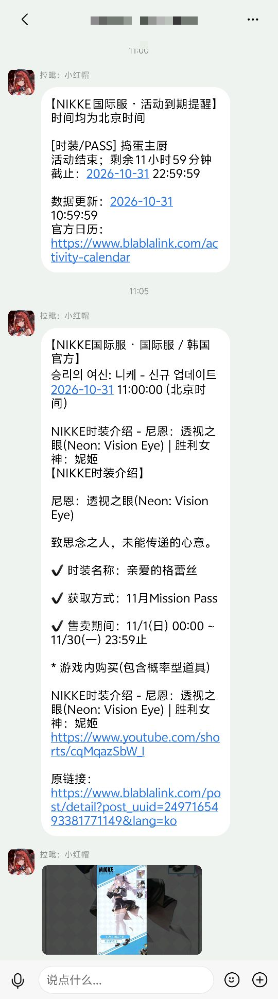
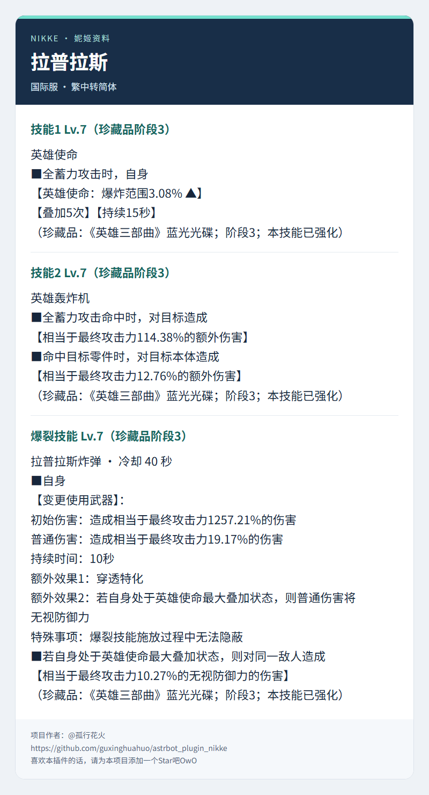

# NIKKE 资讯助手

为 AstrBot 提供《胜利女神：NIKKE》官方资讯订阅、QQ 群图文推送、国际服翻译、活动提醒，以及无需登录的角色与技能查询。

## 功能

- **官方动态**：bilibili 国服使用配置中的 RSSHub 地址；繁中、英文、日文、韩文国际服默认直接访问 BlaBlaLink 官方接口。
- **图文推送**：正文、来源链接、逐张原图与视频封面；SQLite 去重、失败重试和图片续传。
- **聊天订阅管理**：AstrBot 管理员在 QQ 群或私聊中订阅、退订已配置的来源，保存后立即生效。
- **国际服翻译**：英日韩动态翻译为简体中文，参考同帖繁中术语和配图，可选匹配 bilibili 配图。
- **内容筛选**：bilibili 可选大模型筛选抽奖和引流内容，支持 Jev 前置判断。
- **活动提醒**：国际服活动倒计时、提醒档位和夜间汇总。
- **聊天查询**：让 AstrBot 按需查询本群订阅来源的本地资讯存档。
- **角色与技能**：查询 BlaBlaLink 国际服公开角色资料及 1–10 级基础技能，繁中转简体；可作为函数工具供聊天模型调用。

## 效果展示

QQ 群内的活动到期提醒、国际服动态中文翻译与视频封面推送：



<details>
<summary>角色技能图片回复示例</summary>



</details>

## 环境要求

| 项目 | 要求 |
| --- | --- |
| AstrBot | `>=4.10.4` |
| 消息平台 | OneBot v11（`aiocqhttp`）；动态订阅支持 QQ 群及私聊 |
| RSSHub | 仅 bilibili 动态及其配图回退需要；国际服默认直连官方，无需部署 RSSHub |
| 模型 | 翻译、筛选、配图匹配和聊天查询按需使用 AstrBot 已配置的模型 |
| 文转图服务 | 可选；角色图片回复复用 AstrBot 已配置的 t2i 服务 |

自动推送、AI 筛选、翻译和活动提醒初始关闭，按需配置。RSSHub 部署见 [部署指南](deploy/rsshub/README.md)。

## 安装

在 AstrBot 插件市场搜索 **NIKKE 资讯助手**，找到插件后点击安装。

也可在 AstrBot 插件管理中选择「从链接安装」，填写：

```text
https://github.com/guxinghuahuo/astrbot_plugin_nikke
```

也可从 [v1.3.1 发布页](https://github.com/guxinghuahuo/astrbot_plugin_nikke/releases/tag/v1.3.1) 下载 `astrbot_plugin_nikke-v1.3.1.zip`，通过插件管理页上传。依赖由 AstrBot 安装。

## 首次使用

仅使用角色和技能查询，安装后可直接执行 `/nikke 角色 小红帽` 或 `/nikke 技能 小红帽`，无需配置账号、Cookie、RSSHub 或模型。
需要图片回复时，先在 AstrBot 的文转图配置中填写本地 t2i 地址，再开启插件「基础配置 → 角色与技能图片回复」。该开关默认关闭。

资讯订阅和自动推送按以下步骤配置：

1. 仅订阅国际服时无需部署 RSSHub。订阅 bilibili 时，准备可用的 RSSHub 动态源。
2. 在「基础配置」填写「RSSHub 地址」，供 bilibili 使用。「国际服直连官方接口」默认开启；关闭后，国际服也使用同一个 RSSHub 地址，需在该服务部署国际服路由。
3. 在「订阅及目标群」选择来源和语言，填写目标 QQ 群号。连接多个 OneBot 账号时，还需填写 QQ 平台 ID。
4. 管理员执行 `/nikke 检查 NIKKE官方` 确认读取正常；在目标群执行 `/nikke 最新 NIKKE官方` 预览一条真实图文。
5. 开启自动推送。首次成功获取建立基线，之后的新动态才会自动发送。

容器中的 `localhost` 指向容器自身，请根据网络填写服务名或宿主机地址。国际服订阅使用自己设置的名称，例如 `NIKKE国际服`。

## 指令

| 指令 | 用途 | 权限 |
| --- | --- | --- |
| `/nikke`、`/nikke 帮助` | 查看帮助 | 所有人 |
| `/nikke 状态` | 订阅和待投递状态 | AstrBot 管理员 |
| `/nikke 检查 订阅名称` | 检查来源和筛选结果 | AstrBot 管理员 |
| `/nikke 订阅 [订阅名称]` | 不带名称列出来源；指定名称订阅当前群或私聊账号 | AstrBot 管理员 |
| `/nikke 退订 [订阅名称]` | 不带名称列出当前订阅；指定名称退订当前会话 | AstrBot 管理员 |
| `/nikke 最新 订阅名称` | 向当前群发送最新图文 | 对应订阅目标群成员 |
| `/nikke 活动` | 查看活动 | 所有人 |
| `/nikke 基地等级 533` | 该等级满学院的信用点、战斗数据、芯尘每小时产出 | 所有人 |
| `/nikke 红球 h48-32` | 普通默认全通、困难已通关48-32的红球产出 | 所有人 |
| `/nikke 红球 33-23 h18-32` | 普通、困难指定进度的红球产出，参数顺序不限 | 所有人 |
| `/nikke 角色 角色名` | 国际服角色基础属性、武器与技能名称 | 所有人 |
| `/nikke 技能 角色名 [等级]` | 三个基础技能，等级 1–10，默认 10 | 所有人 |

详细选项、翻译策略、筛选规则和投递行为见 [配置与使用](docs/configuration.md)。

先在 WebUI 添加并启用来源，再由 AstrBot 管理员在目标群或私聊中执行 `/nikke 订阅`，
按列出的名称执行，例如 `/nikke 订阅 NIKKE国际服`。退订使用 `/nikke 退订 NIKKE国际服`。
修改会保存到插件配置，重启后保留；只影响当前会话，不改变其他群或账号。
自动推送总开关需开启，首次成功获取只建立基线，不补发历史动态；独立配置的活动提醒不受此操作影响。

角色查询使用 **BlaBlaLink 官方繁中 CDN**，本地转换为简体，保留国际服术语。
支持简繁输入和部分名称匹配；匹配到多个角色时列出候选，需改用完整名称。
例如 `/nikke 技能 拉毗：小红帽 7` 显示 7 级技能，省略等级时显示 10 级。
当前显示基础技能，不包含珍藏品强化。资料按需下载并缓存 24 小时，刷新失败时标注使用旧缓存。

需要大模型查询技能时，开启「聊天查询工具 → 允许模型查询角色技能」（默认关闭），
并在 AstrBot 中允许使用 `nikke_query_character_skills` 工具。聊天模型需支持工具调用。
例如提问“小红帽的10级技能效果是什么？”或“拉毗：小红帽7级技能的倍率是多少？”，
模型可传入角色中文名和等级，省略等级默认10级。工具复用同一份国际服资料和缓存，
群聊、私聊均可使用，无需订阅资讯；结果由模型组织回答，不直接发送图片。

开启「角色与技能图片回复」后，三个技能尽量合并为一张卡片，过长时自动分页，保留来源与资料校验时间。
渲染失败时只返回简短提示；关闭开关后沿用文字回复。名称歧义和参数错误始终用简短文字提示。

## 基地等级与红球

基地与红球查询使用内置国际服静态表，无需联网或账号。只接受上述固定指令；
“前哨”“防御等级”“芯尘表”等写法只提示正确用法，不自动执行。
困难进度必须带 `h`（也接受 `H`），省略普通进度时默认普通全部通关，按内置数据的最后一关 50-36 计算。
例如 `/nikke 红球 h18-32 33-23` 与 `/nikke 红球 33-23 h18-32` 结果相同。
只填 `/nikke 红球 50-36` 会提示补充困难的 `h` 前缀，不再生成增长节点表。
覆盖基地 1–800 级、普通 2-12 至 50-36、困难 h0-1 至 h50-36（含已收录分叉）。
这两项查询固定发送简短文字，按战术学院满级产出显示，不使用 t2i，不附加来源、日期或说明。

## 升级与数据

v1.3.1 增加角色技能函数工具，默认关闭。需要模型按需查询时，开启「聊天查询工具 → 允许模型查询角色技能」，并在 AstrBot 中允许使用该工具。

v1.3.0 增加基地与红球本地查询，支持指定普通、困难进度和参数换序，结果固定为简短文字。

v1.2.0 增加国际服默认直连和管理员聊天订阅、退订，沿用已有配置与数据。

v1.1.0 增加角色、技能查询及可选图片回复，图片开关默认关闭，升级后按需开启。
内部标识仍为 `astrbot_plugin_nikke`，沿用已有配置和 `data/plugin_data/astrbot_plugin_nikke/` 数据。升级前备份配置和数据，升级后重载插件。

RSS 只提供近期内容，长时间停机可能遗漏动态。平台确认发送成功、尚未写入本地记录时进程退出，重启后可能重复发送。国际服目前支持 BlaBlaLink，X 尚未接入；视频以封面和链接呈现。

## 开发与发布

```sh
python -m pip install -r requirements-dev.txt
python -m pytest -q --basetemp=.pytest-tmp
python -m ruff check .
node --test tests/test_blablalink_route.mjs
python scripts/build_package.py
```

测试采用本地服务和 AstrBot 替身。实际部署后仍需检查插件加载、RSS 连通性和目标群图文展示。

打包脚本读取 `metadata.yaml` 的版本，生成安装包和 SHA-256 文件，检查市场的 16 MB 限制。自动检查见 [GitHub Actions](.github/workflows/ci.yml)，发布见 [发布指南](docs/releasing.md)，变更见 [CHANGELOG](CHANGELOG.md)。[配置样例](examples/nas-config.json)中的地址和群号请自行替换。

## 许可证

项目代码采用 [MIT](LICENSE) 许可证。内置 OpenCC 实现与词典遵循 [Apache-2.0](nikke/_vendor/opencc/LICENSE.txt) 和 [NOTICE](nikke/_vendor/opencc/NOTICE.txt)。NIKKE 商标、官方内容及相关图像归各自权利人所有。本项目为社区工具。
